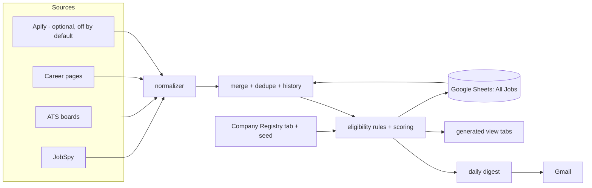
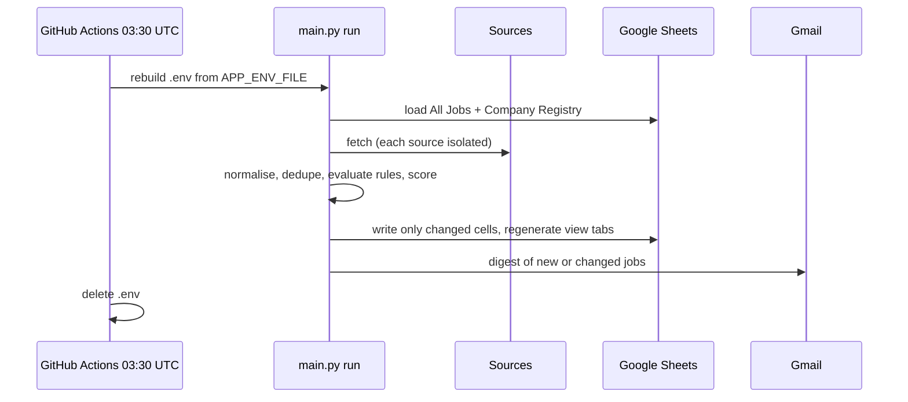

# India Job Intelligence System

A personal, automated India job-discovery pipeline: multiple sources, strict eligibility rules, Google Sheets history, daily e-mail digest. **It never applies to jobs for you.**

## Table of contents

1. [Project introduction](#1-project-introduction)
2. [Key features](#2-key-features)
3. [Eligibility rules](#3-eligibility-rules)
4. [Supported sources](#4-supported-sources)
5. [Technology stack](#5-technology-stack)
6. [System architecture](#6-system-architecture)
7. [How the system works](#7-how-the-system-works)
8. [Job filtering logic](#8-job-filtering-logic)
9. [Deduplication](#9-deduplication)
10. [Job scoring](#10-job-scoring)
11. [Google Sheets database](#11-google-sheets-database)
12. [Daily automation](#12-daily-automation)
13. [Email digest](#13-email-digest)
14. [Project folder structure](#14-project-folder-structure)
15. [Windows installation and setup](#15-windows-installation-and-setup)
16. [Complete configuration reference](#16-complete-configuration-reference)
17. [GitHub deployment](#17-github-deployment)
18. [Security](#18-security)
19. [Testing](#19-testing)
20. [Troubleshooting](#20-troubleshooting)
21. [Limitations](#21-limitations)
22. [Cost breakdown](#22-cost-breakdown)
23. [Roadmap](#23-roadmap)
24. [Licence and acknowledgements](#24-licence-and-acknowledgements)
25. [Disclaimer](#25-disclaimer)

## 1. Project introduction

A personal, automated job-discovery pipeline for India. Every morning (09:00 IST) it collects postings from several independent sources, applies **strict eligibility rules** (experience, pay, company maturity, location), removes duplicates, scores what is left, keeps a permanent history in **Google Sheets**, and e-mails you a digest.

> **It never applies to jobs for you.** It finds and ranks; you decide and apply.

### Honest status (read this first)

| Area | State |
|---|---|
| Rules engine (experience, CTC, stipend, location, company), dedup, history, scoring, digest, Sheets diff logic | **Implemented and locally tested** (`pytest`: 191 passed on Python 3.13) |
| Offline demo (`python main.py demo`) | Works |
| Live job sources (JobSpy, ATS boards, career pages, Apify) and Gemini | **Implemented but never run against the real services.** The build environment had no access to them. Parsing/limits were tested only against hand-written fixtures and fakes |
| Real Google Sheets API, real Gmail delivery | **Not tested live.** Tested against in-memory fakes |
| GitHub Actions workflows | Written and YAML-validated, **never executed on GitHub**. No status badge is shown because none was earned |

Do the first-run steps in [section 15](#15-windows-installation-and-setup) (`check`, then `--dry-run`) and expect to fix small things.

## 2. Key features

- Four source families: **JobSpy**, **ATS public job boards**, **career-page JSON-LD**, and **optional paid Apify actors** (all off by default). Each source is independent; one failing never stops the others.
- **Google Sheets is the only database** (no other DB). 15 tabs (the 13 requested plus *Company Registry* and *Location Verification Required*), permanent master "All Jobs".
- Strict, configurable rules enforced in code; every decision is explained per job.
- Unverified information never silently decides eligibility (company seed, ambiguous remote roles, unclear pay and experience all surface as *Verification Required* or a visible warning).
- Your manual **Application Status** and **Notes** are never overwritten.
- Daily Gmail digest, GitHub Actions schedule, optional Gemini helper (rules-based fallback always works).

## 3. Eligibility rules

All thresholds are in `.env` (defaults shown). Rules are enforced in `processing/` and covered by tests.

**Experience (every job, including internships): maximum 3 years**

| Posting says | Result |
|---|---|
| Freshers, 0, 0-1, 0-2, 0-3, 1-2, 1-3, 2-3 years | Eligible |
| 2-4, 3-5, 3+, 4+, 5+, 0-5 years | Excluded |
| Nothing stated, ambiguous, open-ended "minimum 2 years" | **Experience Verification Required** |

Job titles (Junior, Associate, Executive, Trainee, Intern) are **never** used to infer eligibility.

**Full-time pay: CTC >= 8 LPA**

| Posting says | Result |
|---|---|
| 8 LPA or more (lowest stated figure) | Eligible |
| 7 LPA; "up to 7 LPA" | Excluded |
| 6-10 LPA (range crosses 8); "up to 12 LPA" (minimum unknown) | **Salary Verification Required** |
| Fixed/base/in-hand/variable/OTE figures; per-month figures | **Salary Verification Required** (not treated as CTC) |
| No figure | **Salary Undisclosed** |

**Internships: stipend >= Rs 10,000 per month**

| Posting says | Result |
|---|---|
| Rs 10,000 / 15,000 per month | Eligible |
| Rs 8,000 / 9,999 per month; unpaid | Excluded |
| Rs 8,000-12,000 (range crosses 10,000); "up to Rs 15,000" | **Salary Verification Required** |
| Not stated / unclear period | **Salary/Stipend Undisclosed** |
| Weekly / yearly / total stipend | Converted only when the duration is stated |

**Location:** all Indian cities/states, hybrid in India, relocation within India. A remote job must say it is open to candidates in India. Explicit foreign locations are dropped (mentioning India does not rescue them). Remote or vague locations with no stated eligibility go to **Location Verification Required**.

**Company:** startups need age >= 5 years **and** >= 90 employees (unknown = *Company Verification Required*; clearly too young/small = Excluded). All other companies (MNC, large Indian, SME, bank, consulting, FMCG, ...) have no age or headcount limit. Unknown classification = *Company Verification Required*.

Full detail and precedence: [docs/FILTERING_LOGIC.md](docs/FILTERING_LOGIC.md).

## 4. Supported sources

| Source | Status |
|---|---|
| JobSpy: Naukri, Indeed, LinkedIn (default); Glassdoor, Google (optional) | Implemented, **not tested live** |
| ATS boards: Greenhouse, Lever | Implemented, parser **tested on fixtures**, endpoint not tested live |
| ATS boards: Ashby, SmartRecruiters, Workable, Recruitee, Personio, Teamtailor, Breezy, Workday, Oracle Recruiting | Implemented, **not tested** |
| Career pages (schema.org JSON-LD) | Implemented, **not tested**; no pages are configured by default |
| Apify actors: Naukri, LinkedIn, IIMJobs, Glassdoor, Google Jobs, Workday | **Experimental**, off by default, never run. Spend gating and limits are tested with fakes. IIMJobs is optional and never a dependency |
| Gemini helper | Implemented; retry/cache/limits tested with a fake |
| Hirist, Foundit, Shine, Instahyre, TimesJobs | **Unsupported** (no public API, not in JobSpy) |
| SuccessFactors, iCIMS, Jobvite, Zoho Recruit, Rippling, Eightfold, Pinpoint | **Unsupported** |

`config/targets.yaml` ships with **5 example boards from foreign employers and no career pages**: no Indian employer identifiers were added because none could be verified without live access, and inventing them is not acceptable. **This is not exhaustive coverage of Indian jobs.** Add your own boards, then run `python main.py validate-targets`. Details: [docs/CONNECTORS.md](docs/CONNECTORS.md).

## 5. Technology stack

Python 3.12+ (tested on 3.13) · `python-jobspy` · `requests` (+ `urllib3` 2.x retries) · `beautifulsoup4` · `gspread` + `google-auth` · `tenacity` · `rapidfuzz` · `PyYAML` · `python-dotenv` · `tzdata` · `pytest`. Storage: Google Sheets. Automation: GitHub Actions. E-mail: Gmail SMTP.

## 6. System architecture



More: [docs/ARCHITECTURE.md](docs/ARCHITECTURE.md).

## 7. How the system works



Extraction (numbers from text) is separate from the decision (thresholds). The numbers are stored, so changing a threshold in `.env` re-classifies existing rows on the next run.

## 8. Job filtering logic

Category precedence (first match wins): **Excluded > Experience Verification > Location Verification > Company Verification > Salary Verification > Salary Undisclosed > Paid Internships / Strong / Possible**. A high score never overrides a failed rule. See [docs/FILTERING_LOGIC.md](docs/FILTERING_LOGIC.md).

## 9. Deduplication

The same posting on several sources is merged using source ids, canonical URLs and fuzzy company/title/city/description similarity. **Different locations are different jobs.** All source URLs are kept. A repost of a closed job is counted (*Repost Count*). Duplicates update the existing row instead of adding a new one.

## 10. Job scoring

A 0-100 score for ranking only: function fit 30, experience 15, pay 15, location 10, company 7, job type 5, description quality 5, skills 5, freshness 5, direct apply link 3, with a plain-English *Match Explanation* per job. Strong >= 70, Possible >= 45 (configurable).

## 11. Google Sheets database

| Tab | Purpose |
|---|---|
| **All Jobs** | Permanent master. Columns A-B (*Application Status*, *Notes*) are yours |
| New Today, Strong Matches, Possible Matches, Paid Internships, Salary Undisclosed, Salary Verification Required, Company Verification Required, Experience Verification Required, Location Verification Required, Applied, Rejected and Closed | Generated each run. **Edit only in All Jobs.** |
| Source Statistics, System Logs | Append-only history |
| Company Registry | Your verified company facts (below) |

Safety: jobs are never deleted; only changed cells are written; your two manual columns are never written for existing rows; if rows were re-ordered during a run, the write is aborted. First/last-seen dates and all source URLs are kept. Quota/server errors are retried with back-off; permanent errors (permission, not found) are not. Meaning of every column: [docs/DATA_DICTIONARY.md](docs/DATA_DICTIONARY.md).

**Company Registry.** Unknown companies are added automatically. Fill *Classification* and, for startups, *Founded Year*, *Employee Count* and an *Evidence / Source URL*. Your rows always win. The bundled `config/company_seed.yaml` (234 well-known employers) is **UNVERIFIED general knowledge with no recorded evidence**; jobs relying on it carry a visible warning, and `COMPANY_SEED_MODE=strict` ignores it entirely.

## 12. Daily automation

`.github/workflows/daily_jobs.yml` runs on cron `30 3 * * *` (03:30 UTC = **09:00 IST**) and on manual dispatch (with a *dry run* option). GitHub may start scheduled jobs several minutes late. Never run on GitHub so far (untested).

## 13. Email digest

Only new or materially changed jobs, grouped by category with a cap per section (unverified-company jobs grouped by company), plus source health and Apify spend. A job is e-mailed once until it changes. Content is HTML-escaped and only valid `http(s)` links are clickable.

## 14. Project folder structure

```text
india-job-intelligence-system/
├── .github/
│   ├── ISSUE_TEMPLATE/
│   │   ├── bug_report.md
│   │   └── connector_request.md
│   └── workflows/
│       ├── daily_jobs.yml   # daily 09:00 IST run + manual run
│       └── tests.yml   # runs pytest
├── config/
│   ├── __init__.py
│   ├── company_seed.yaml   # UNVERIFIED seed of well-known employers
│   ├── profile.py   # target functions, search queries
│   ├── settings.py   # the ONLY code that reads .env
│   └── targets.yaml   # ATS boards + career pages you want watched
├── connectors/
│   ├── __init__.py
│   ├── apify_connector.py   # optional paid Apify actors
│   ├── ats_connector.py   # ATS public job boards
│   ├── base.py   # connector base class
│   ├── career_page_connector.py   # JSON-LD career pages
│   └── jobspy_connector.py   # JobSpy sites
├── core/
│   ├── __init__.py
│   ├── http.py   # HTTP client (retries, jitter)
│   ├── logging_setup.py
│   ├── models.py   # Job model + sheet columns
│   └── textutil.py
├── demo/
│   ├── __init__.py
│   └── sample_jobs.py   # invented demo postings
├── docs/
│   ├── ACCEPTANCE_AUDIT.md
│   ├── ARCHITECTURE.md
│   ├── CONFIGURATION.md
│   ├── CONNECTORS.md
│   ├── DATA_DICTIONARY.md
│   ├── DEPLOYMENT.md
│   ├── FILTERING_LOGIC.md
│   ├── REPOSITORY_AUDIT.md
│   ├── TESTING.md
│   └── TROUBLESHOOTING.md
├── integrations/
│   ├── __init__.py
│   ├── email.py   # Gmail SMTP sender
│   ├── google_sheets.py   # Google Sheets database
│   ├── sheet_schema.py   # tabs and generated views
│   └── store.py   # storage interface + in-memory test double
├── processing/
│   ├── __init__.py
│   ├── ai_assist.py   # optional Gemini helper
│   ├── company_verification.py   # startup rules + company registry
│   ├── deduplication.py   # cross-source duplicate detection
│   ├── eligibility.py   # combines all rules into a category
│   ├── experience_filter.py   # experience extraction + 3-year rule
│   ├── geo_india.py   # India / remote eligibility
│   ├── lifecycle.py   # history merge, closing, reposts
│   ├── normalizer.py   # cleans each posting
│   ├── pipeline.py   # the daily run
│   ├── salary_filter.py   # CTC / stipend extraction + thresholds
│   └── scoring.py   # 0-100 score
├── reports/
│   ├── __init__.py
│   └── daily_digest.py   # builds the e-mail
├── tests/
│   ├── __init__.py
│   ├── conftest.py
│   ├── helpers.py
│   ├── test_apify_gemini_mocked.py
│   ├── test_company_registry.py
│   ├── test_config.py
│   ├── test_connectors.py
│   ├── test_dedup_history.py
│   ├── test_email_and_urls.py
│   ├── test_experience.py
│   ├── test_http_retries.py
│   ├── test_location.py
│   ├── test_pipeline.py
│   ├── test_rules.py
│   ├── test_salary.py
│   ├── test_scoring.py
│   ├── test_security_and_workflow.py
│   ├── test_sheets_retries.py
│   └── test_sheets_store_fake.py
├── .env.example   # safe template; copy to .env
├── .gitignore
├── CONTRIBUTING.md
├── LICENSE   # MIT
├── main.py   # command line: demo | check | validate-targets | run
├── README.md   # this file
├── requirements-dev.txt
├── requirements.txt
└── THIRD_PARTY_NOTICES.md   # credits and licences of reused work
```

## 15. Windows installation and setup

**A. Install tools.** Python 3.12+ from python.org (tick *Add python.exe to PATH*), Git, optionally VS Code.

**B. Set up the project** (PowerShell, inside the extracted folder):

```powershell
python -m venv .venv
.\.venv\Scripts\Activate.ps1      # if blocked: Set-ExecutionPolicy -Scope CurrentUser RemoteSigned
pip install -r requirements.txt
copy .env.example .env
python main.py demo               # works with no accounts
```

**C. Google Sheet + service account (Google Cloud)**

1. Create an empty Google Sheet; copy the ID from its URL (`.../d/<ID>/edit`) into `GOOGLE_SHEET_ID`.
2. <https://console.cloud.google.com>: create a project; *APIs & Services > Library > Google Sheets API > Enable*.
3. *IAM & Admin > Service Accounts > Create*; open it > *Keys > Add key > JSON*. Keep the downloaded file **outside the project folder**.
4. Convert to a single Base64 line and paste after `GOOGLE_SERVICE_ACCOUNT_JSON_BASE64=`:
   ```powershell
   [Convert]::ToBase64String([IO.File]::ReadAllBytes("C:\path\to\key.json"))
   ```
5. **Share the sheet** (Share button) with the `client_email` from that JSON, as **Editor**.
6. Delete the downloaded JSON when done.

**D. Gmail App Password.** Turn on 2-Step Verification; Google Account > Security > *App passwords*; create one; put the 16 characters in `GMAIL_APP_PASSWORD`, and set `GMAIL_ADDRESS` and `EMAIL_RECIPIENT`.

**E. First run (in this order)**

```powershell
python main.py check               # validates .env, opens the sheet, creates the tabs
python main.py validate-targets    # tests each ATS board (internet)
python main.py run --dry-run       # fetches and evaluates; writes and sends nothing
python main.py run                 # real run
```

## 16. Complete configuration reference

One file: the root `.env`. Reference of every variable: [docs/CONFIGURATION.md](docs/CONFIGURATION.md). Minimal example:

```ini
GOOGLE_SHEET_ID=1AbCdEfGhIjKlMnOpQrStUvWxYz
GOOGLE_SERVICE_ACCOUNT_JSON_BASE64=<one long line>
GMAIL_ADDRESS=you@gmail.com
GMAIL_APP_PASSWORD=<16 characters>
EMAIL_RECIPIENT=you@gmail.com
MAXIMUM_EXPERIENCE_YEARS=3
MINIMUM_CTC_LPA=8
MINIMUM_INTERNSHIP_STIPEND_INR_MONTHLY=10000
APIFY_ENABLED=false
```

## 17. GitHub deployment

```powershell
git init
git add .
git status          # confirm .env is NOT listed
git commit -m "Initial commit"
git branch -M main
git remote add origin https://github.com/<you>/<repo>.git
git push -u origin main
```

**APP_ENV_FILE (the only secret).** Repository > *Settings > Secrets and variables > Actions > New repository secret*; name `APP_ENV_FILE`; value = the **entire contents** of your local `.env`. The workflow rebuilds `.env` from it, masks the values, never commits or uploads it, and deletes it afterwards.

**Manual run.** *Actions > Daily job run > Run workflow* (tick *Dry run* the first time). Use a **private** repository. Full steps: [docs/DEPLOYMENT.md](docs/DEPLOYMENT.md).

## 18. Security

- No keys in code; secrets only in `.env` (git-ignored) or the single GitHub secret. No credentials JSON in the project.
- Log output redacts configured secret values; workflow masks values, has `contents: read` only, uploads no artifacts.
- Sheet values are written as plain text (`RAW`), so scraped text cannot become a formula. E-mail is HTML-escaped; non-http(s) links are dropped at ingestion.
- Network: capped, jittered back-off; `Retry-After` honoured (max 60 s); permanent errors are not retried; **POST (e.g. Apify "start run") is never auto-retried**, so a paid run cannot be started twice by a retry.
- No CAPTCHA/login bypass, no auto-apply, `robots.txt` respected on career pages.

## 19. Testing

```powershell
pip install -r requirements-dev.txt
python -m compileall -q .
pytest -q
python main.py demo
```

Result when this README was written: **191 passed** (Linux, Python 3.13), compile check clean, demo runs. The tests cover every rule table above, dedup, history and manual-status preservation, Sheets diffing/retries (fake), HTTP retries (local loopback server), e-mail escaping, config/credentials, Apify gating/limits (fake), Gemini (fake) and workflow settings. **Not tested:** any live network call, real Google/Gmail APIs, GitHub Actions. See [docs/TESTING.md](docs/TESTING.md).

## 20. Troubleshooting

Common problems (sheet permission, Base64, Gmail login, blocked sources, too many verification rows) are in [docs/TROUBLESHOOTING.md](docs/TROUBLESHOOTING.md).

## 21. Limitations

- Live sources were never run; expect fixes on first use. LinkedIn/Indeed often block cloud IPs.
- Coverage of Indian employers is whatever you configure plus what JobSpy returns. Not exhaustive.
- Hirist and similar Indian boards are unsupported.
- Salary/experience extraction is pattern-based on free text; unusual wording lands in *Verification Required* by design.
- Remote or vague locations are sent to *Location Verification Required* (a category added beyond the original 13 tabs).
- The company seed is unverified; startup status needs your evidence.
- Google Sheets cell limit (10 million) and API quotas apply.

## 22. Cost breakdown

| Item | Cost |
|---|---|
| Python libraries, JobSpy, Google Sheets, Gmail SMTP | Free |
| GitHub Actions | Free allowance for the run length expected here; check GitHub's current plan limits |
| Gemini (optional) | Has a free tier at the time of writing; limits change. Off if no key |
| Apify (optional) | **Paid**, off by default. You set a per-run dollar budget; prices in the code are estimates from 2026-11-24. Also set a monthly cap in the Apify console |

## 23. Roadmap

Planned, **not implemented**: verified Indian ATS board list, Hirist/Foundit via compliant routes if any exist, company evidence helper, a read-only summary dashboard tab.

## 24. Licence and acknowledgements

MIT ([LICENSE](LICENSE)). Credits and third-party licences: [THIRD_PARTY_NOTICES.md](THIRD_PARTY_NOTICES.md). Repository research: [docs/REPOSITORY_AUDIT.md](docs/REPOSITORY_AUDIT.md). Quality audit of this version: [docs/ACCEPTANCE_AUDIT.md](docs/ACCEPTANCE_AUDIT.md). Contributing: [CONTRIBUTING.md](CONTRIBUTING.md).

## 25. Disclaimer

Provided as is, without warranty. Job-board terms of service may restrict automated access; you are responsible for how you use JobSpy, Apify and any source. Postings and pay shown may be wrong or outdated: verify on the employer's page before applying. This tool gives no employment, legal or financial advice.
