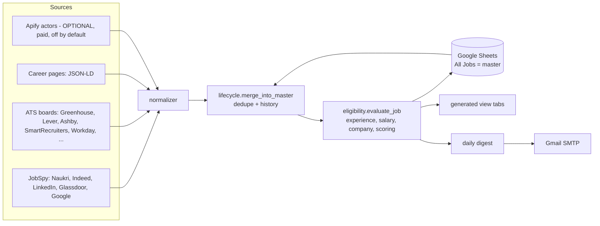

# Architecture

## Data flow

## Modules

| Folder | Responsibility |
|---|---|
| `config/` | `settings.py` (the only code that reads `.env`), `profile.py` (functions, search queries), `targets.yaml`, `company_seed.yaml` |
| `core/` | `Job` dataclass and the 70-column sheet schema, text helpers, HTTP client (timeouts, retries, per-host delay), log redaction |
| `connectors/` | One class per source. All return `ConnectorResult` containing common-schema `Job` objects. A failing connector never stops the run |
| `processing/` | `normalizer`, `geo_india`, `experience_filter`, `salary_filter`, `company_verification`, `scoring`, `eligibility`, `deduplication`, `lifecycle`, `ai_assist`, `pipeline` |
| `integrations/` | `google_sheets.py` (the database), `sheet_schema.py` (tabs, views), `store.py` (interface and in-memory test double), `email.py` |
| `reports/` | `daily_digest.py` |
| `demo/` | Invented sample postings for `python main.py demo` |

## Key design decisions

1. **Two-phase evaluation.** Extraction (numbers from text) is separate from the decision (thresholds). The numbers are stored in the sheet, so changing `MINIMUM_CTC_LPA` re-classifies existing rows on the next run without re-reading descriptions.
2. **Google Sheets is the only database.** No other DB is used. The `Store` interface exists so the pipeline can be tested without Google.
3. **Your edits are safe.** *Application Status* and *Notes* exist only in the `All Jobs` tab and are never written for an existing row. Before every write the program re-reads the Internal Job ID column and aborts without writing if rows were sorted, inserted or deleted meanwhile. View tabs are regenerated each run (read-only by convention).
4. **History is permanent.** Jobs are never deleted. A job is `Closed` only if the board it came from was fetched completely and it was absent for `CLOSE_AFTER_MISSED_RUNS` runs; otherwise it can only become `Possibly Closed` after `STALE_AFTER_DAYS`. A failed source cannot close anything.
5. **Fail safe.** Each connector, each board and each record is isolated. Email failure does not fail the run; sheet failure does (so you notice).
6. **A score never overrides a rule.** Category precedence is in `FILTERING_LOGIC.md`.
7. **Cost control.** Apify needs four independent opt-ins and a dollar budget (see `CONFIGURATION.md`).

## AI, monitoring and discovery (added later)

- `integrations/ai_providers.py` (adapters + retry/backoff + redaction), `integrations/ai_router.py` (priority, fail-over, cool-downs, limits),
  `processing/ai_assist.py` (gates + usage counters), `processing/ai_cache.py` ("AI Cache" tab). See [AI_PROVIDERS.md](AI_PROVIDERS.md).
- `processing/monitoring.py`: source issues, alert de-duplication, change log, Company Registry work queue.
- `discovery/board_discovery.py`: verified ATS board finder (report only).
